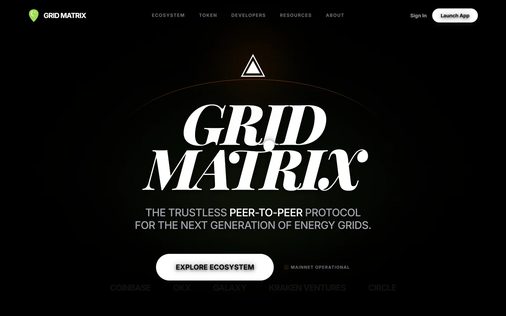
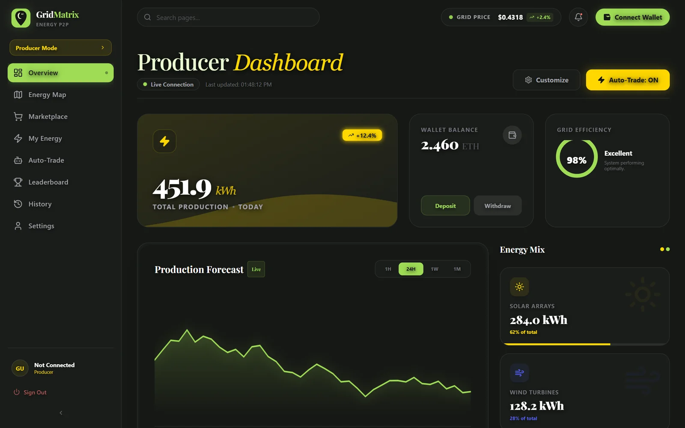
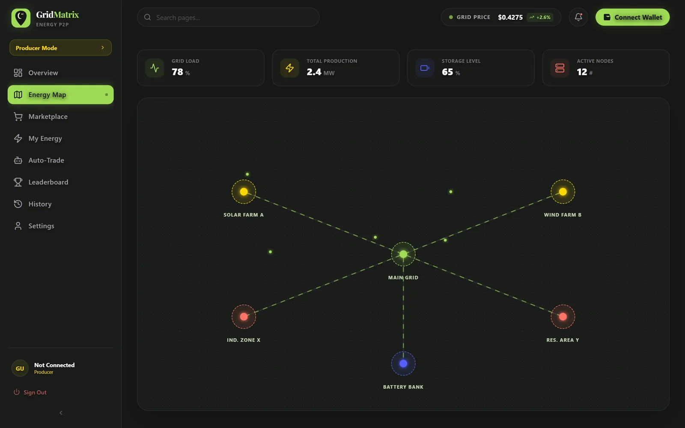
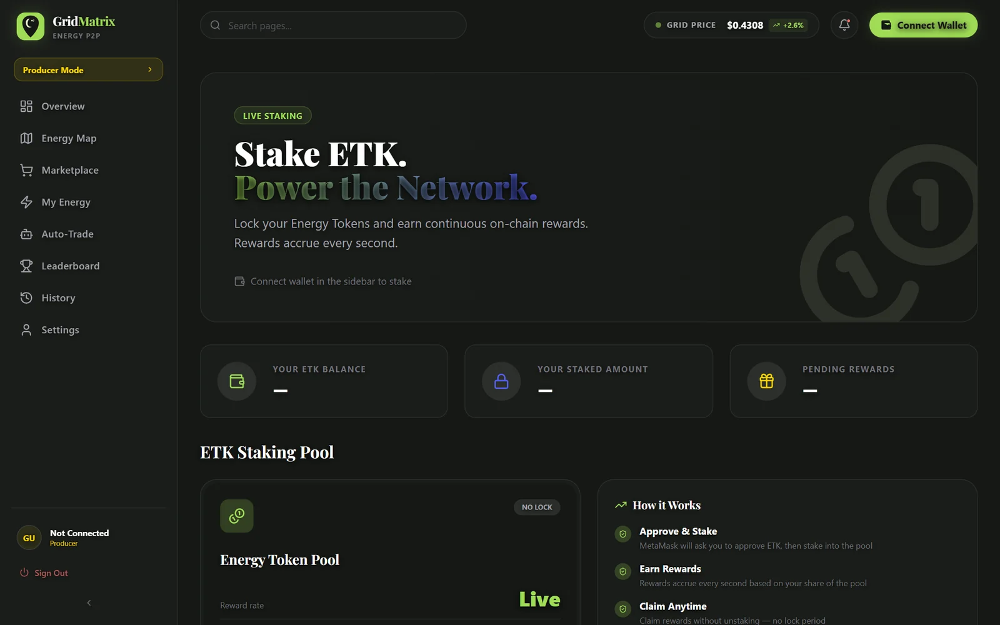
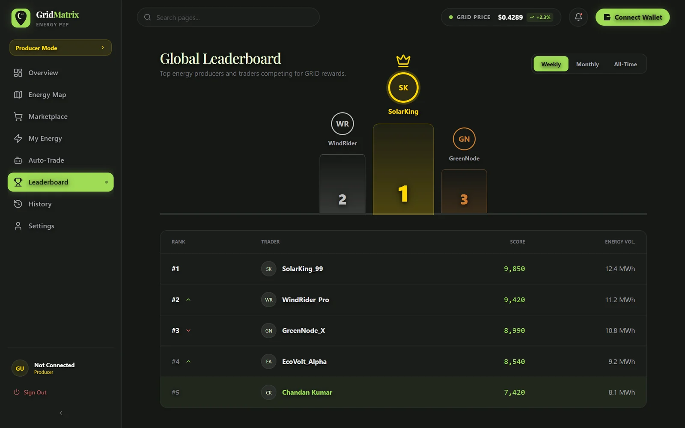
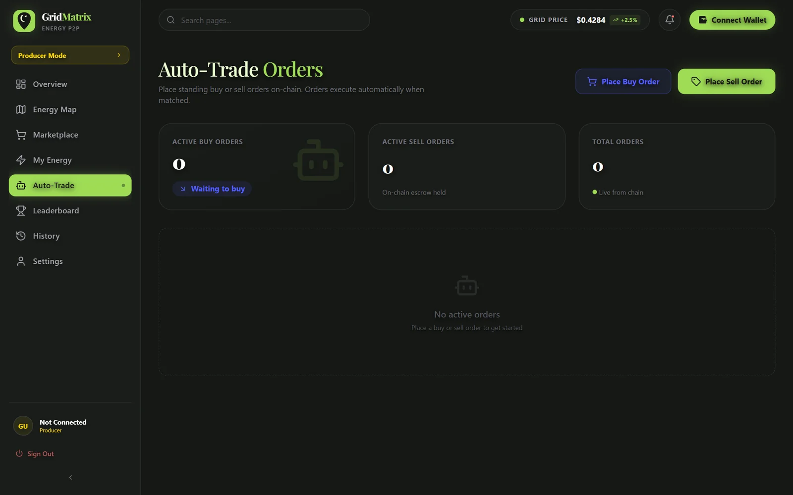
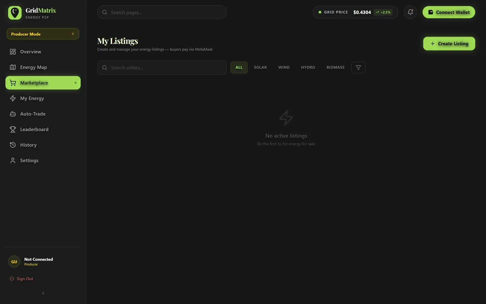

<div align="center">

# GridMatrix

**Peer-to-peer renewable energy trading on Ethereum. Solar and wind producers sell surplus energy straight to their neighbours as tokens, with no utility in the middle.**

K.R. Mangalam University Hackathon 2026



</div>

## The idea

In the usual grid, a home solar producer sells to the utility and the neighbour buys from the utility, which takes its margin in between. GridMatrix replaces that middle with smart contracts:

- **Producers** tokenise surplus energy as **ETK** (1 ETK = 1 kWh) and list it for sale.
- **Consumers** buy from a live marketplace at prices set by peers.
- **Stakers** lock ETK and earn rewards every second.
- **Traders** place standing buy and sell orders that execute on-chain.

## Screens

<table>
  <tr>
    <td width="50%"></td>
    <td width="50%"></td>
  </tr>
  <tr>
    <td><b>Producer dashboard.</b> Today's production, wallet balance, grid efficiency, the production forecast and the solar/wind energy mix.</td>
    <td><b>Energy map.</b> Solar farms, wind farms, industrial zones and a battery bank around the local grid hub.</td>
  </tr>
  <tr>
    <td></td>
    <td></td>
  </tr>
  <tr>
    <td><b>Staking.</b> Stake ETK into the energy token pool; rewards accrue every second.</td>
    <td><b>Leaderboard.</b> Top producers and traders by score and energy traded.</td>
  </tr>
  <tr>
    <td></td>
    <td></td>
  </tr>
  <tr>
    <td><b>Auto-trade.</b> Standing buy and sell orders, executed automatically when matched.</td>
    <td><b>Marketplace.</b> Create a listing and filter offers by solar, wind, hydro or biomass. Fills with live listings once the contracts are deployed and seeded.</td>
  </tr>
</table>

## Smart contracts

Solidity 0.8.20 with OpenZeppelin, in `energy-contracts/contracts/`:

| Contract | Purpose | Key functions |
|---|---|---|
| `EnergyToken.sol` | ERC-20 token, 1 ETK = 1 kWh | `mint()`, `consume()` |
| `EnergyMarket.sol` | P2P marketplace; ETH is held in escrow until ETK is delivered | `listEnergy()`, `buyEnergy()`, `cancelListing()` |
| `EnergyStaking.sol` | Stake ETK and earn rewards calculated per second from block timestamps | `stake()`, `unstake()`, `claimReward()`, `pendingReward()` |
| `AutoTrade.sol` | Standing orders stored on-chain | `placeBuyOrder()`, `placeSellOrder()`, `executeBuyOrder()`, `executeSellOrder()`, `cancelBuyOrder()`, `cancelSellOrder()` |

## Architecture

```
React frontend (grid-matrix---p2p-energy-trading)
  landing page, dashboard, marketplace, staking, auto-trade, leaderboard
        │  ethers.js v6 + MetaMask (src/hooks/useContracts.ts)
        ▼
Smart contracts (energy-contracts)
  EnergyToken · EnergyMarket · EnergyStaking · AutoTrade
        │
        ▼
Hardhat local node  ·  localhost:8545  ·  chain ID 31337
```

## Run locally

Requires Node 18+ and the MetaMask extension.

```bash
# 1. local blockchain
cd energy-contracts
npm install
npm run node              # localhost:8545

# 2. deploy and seed (new terminal)
cd energy-contracts
npm run deploy            # deploys all 4 contracts
npm run seed              # demo listings, staking positions and orders

# 3. frontend (new terminal)
cd grid-matrix---p2p-energy-trading
npm install
npm run dev               # http://localhost:3000
```

In MetaMask, add the network (RPC `http://127.0.0.1:8545`, chain ID `31337`, symbol `ETH`) and import one of the test accounts that `npm run node` prints. Hardhat test accounts are public, so never send real funds to them.

## Project structure

```
grid-matrix---p2p-energy-trading/   React frontend
  pages/                            Dashboard, Marketplace, Staking, AutoTrade, EnergyMap, ...
  components/                       landing page sections
  src/lib/                          contract ABIs, ethers helpers, deployment addresses
  src/hooks/useContracts.ts         React hooks for the contracts
energy-contracts/                   Solidity contracts, deploy and seed scripts
stability-protocol---web3-ecosystem/  wallet landing page
Project_Documents/                  architecture and implementation plan
```

## Tech stack

React 19, TypeScript, Vite, Tailwind CSS, ethers.js v6, MetaMask, Solidity 0.8.20, OpenZeppelin, Hardhat.
